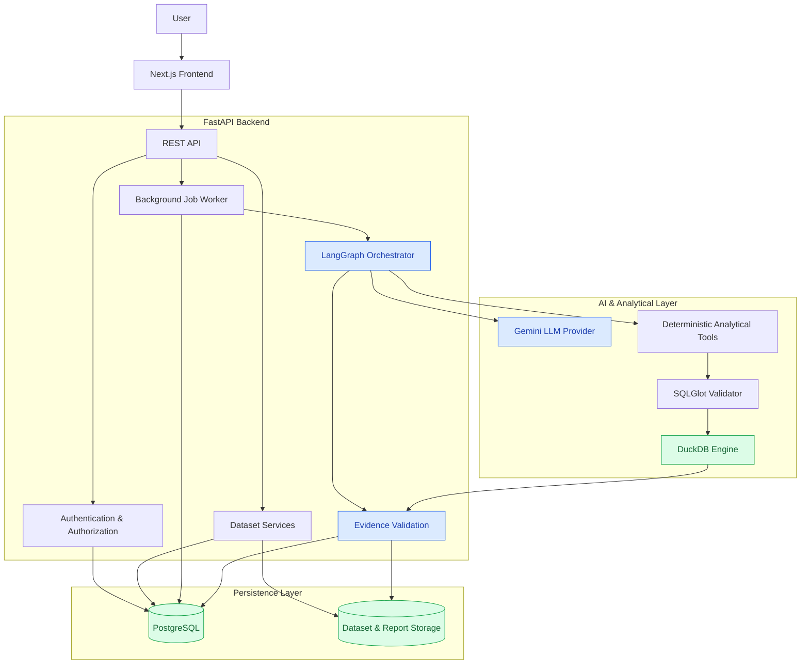
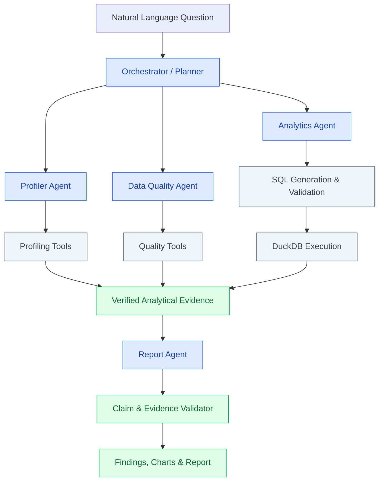
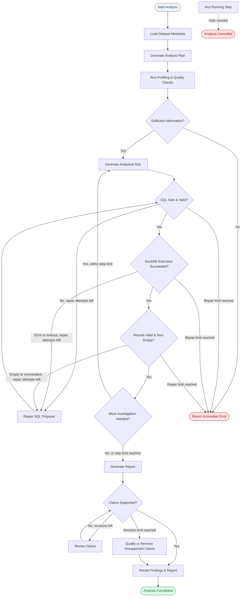
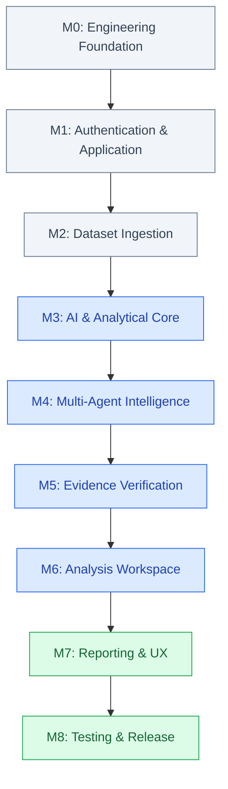
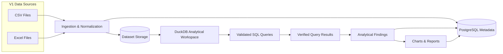

# AnalytIQ

### Intelligent Analysis. Verified Insights.

**An evidence-grounded, multi-agent AI data analytics platform.**

AnalytIQ is an AI Engineering portfolio project designed to transform structured datasets into trustworthy, explainable, and actionable analytical insights.

Powered by **LangGraph, Google Gemini, FastAPI, DuckDB, and Next.js**, AnalytIQ combines AI-driven analytical reasoning with deterministic data processing, safe SQL execution, and evidence-backed reporting.

> **Core Engineering Principle**
>
> AI plans and interprets. Deterministic tools calculate. Evidence validates. AnalytIQ explains.

**Project Status:** Planning Complete · M0 Pending  
**Current Target:** AnalytIQ V1.0  
**License:** MIT

---

## Table of Contents

1. [Overview](#overview)
2. [Project Objectives](#project-objectives)
3. [Core Features](#core-features)
4. [System Architecture](#system-architecture)
5. [Multi-Agent Architecture](#multi-agent-architecture)
6. [Analytical Workflow](#analytical-workflow)
7. [Technology Stack](#technology-stack)
8. [Repository Structure](#repository-structure)
9. [Development Roadmap](#development-roadmap)
10. [Database Architecture](#database-architecture)
11. [Security and Reliability](#security-and-reliability)
12. [Feature Boundaries](#feature-boundaries)
13. [Development Principles](#development-principles)
14. [Getting Started](#getting-started)
15. [Future Enhancements](#future-enhancements)
16. [License](#license)

---

## Overview

Traditional text-to-SQL applications typically convert natural-language questions into SQL queries and summarize the returned results.

AnalytIQ is designed to go further.

Instead of relying on a single LLM response, AnalytIQ coordinates specialized AI agents to understand analytical questions, inspect datasets, assess data quality, plan investigations, execute validated SQL queries, and produce evidence-backed findings.

The platform separates **probabilistic AI reasoning** from **deterministic analytical computation**.

This architecture aims to improve analytical correctness, transparency, reproducibility, and user trust.

### Example Use Case

A user uploads a sales dataset and asks:

> Why did our revenue decrease in March?

AnalytIQ is designed to:

1. Inspect the dataset schema and identify relevant columns.
2. Evaluate missing values, duplicates, and data-quality issues.
3. Determine the appropriate revenue metric and comparison periods.
4. Plan a month-over-month analytical investigation.
5. Generate and validate analytical SQL.
6. Execute queries using DuckDB.
7. Investigate relevant product, regional, or customer segments.
8. Validate numerical findings against actual query results.
9. Generate charts and an evidence-backed analytical report.

If the available data cannot establish a cause, AnalytIQ should explicitly communicate that limitation rather than invent an explanation.

---

## Project Objectives

AnalytIQ is designed around five engineering objectives.

| Objective | Description |
|---|---|
| Multi-Agent Intelligence | Coordinate specialized AI agents through stateful workflows |
| Analytical Correctness | Use deterministic tools for calculations and SQL execution |
| Evidence Grounding | Connect analytical claims to validated query results |
| Explainability | Expose SQL evidence, execution traces, and analytical limitations |
| Engineering Reliability | Apply structured outputs, security boundaries, testing, and observability |

The project also demonstrates practical AI Engineering concepts including LLM orchestration, tool calling, structured generation, safe execution, workflow state management, and backend integration.

---

## Core Features

The following features define the planned **AnalytIQ V1.0 portfolio release**.

### 1. User and Workspace Management

- User registration, login, and logout.
- Protected user workspaces.
- User-specific dataset and analysis ownership.
- Dashboard with recent datasets and analyses.
- Account settings.

### 2. Dataset Management

- CSV and XLSX uploads.
- Dataset schema detection.
- Column type identification.
- Paginated dataset preview.
- Column-level statistical profiling.
- Missing-value and duplicate detection.
- Data-quality summaries.
- Dataset lifecycle management.

### 3. Multi-Agent AI Analysis

- LangGraph-based workflow orchestration.
- Natural-language analytical questions.
- Structured analytical planning.
- Specialized profiling, quality, analytics, and reporting agents.
- Gemini-powered reasoning.
- Controlled SQL generation and repair.
- Bounded multi-step analytical investigations.

### 4. Safe Analytical Execution

- DuckDB-based analytical SQL engine.
- SQLGlot AST-based query validation.
- Authorized table and column access.
- Read-only query execution.
- Query timeouts and resource limits.
- Structured result validation.
- Numerical evidence verification.

### 5. Interactive Analysis Workspace

- Natural-language question interface.
- Live analysis progress.
- Agent execution timeline.
- Verified analytical findings.
- Interactive Recharts visualizations.
- SQL query inspection.
- Evidence Explorer.
- Analysis history.

### 6. Reporting and Reliability

- Downloadable PDF reports.
- Persistent analytical history.
- Background analysis execution.
- Analysis cancellation.
- Structured logging.
- Agent execution traces.
- Automated tests and quality checks.
- Responsive frontend design.

---

## System Architecture

AnalytIQ follows a **modular monolith architecture**, keeping the frontend, backend, AI orchestration, analytical execution, and persistence layers logically separated.



### Architectural Responsibilities

**Frontend — Next.js**

Provides the dashboard, dataset explorer, analysis workspace, charts, and reporting interface.

**Backend — FastAPI**

Handles authentication, authorization, uploads, business logic, API contracts, and background job coordination.

**AI Orchestration — LangGraph**

Coordinates analytical planning, specialist agents, tool execution, and controlled workflow transitions.

**Analytical Engine — DuckDB**

Executes analytical SQL against approved dataset workspaces.

**Application Database — PostgreSQL**

Stores user accounts, dataset metadata, analysis history, agent traces, findings, and report metadata.

**LLM Provider — Gemini**

Performs analytical planning, SQL proposal generation, interpretation, and report composition.

---

## Multi-Agent Architecture

AnalytIQ uses one coordinating orchestrator and four specialist agents.

| Component | Responsibility |
|---|---|
| Orchestrator | Understand the question, create an analysis plan, and coordinate execution |
| Profiler Agent | Interpret dataset structure and statistical profiles |
| Data Quality Agent | Interpret missing values, duplicates, and quality issues |
| Analytics Agent | Generate analytical SQL and investigate query results |
| Report Agent | Compose explanations and reports using verified evidence |

Profiling calculations, SQL execution, statistical computations, and chart-data generation are performed by deterministic tools rather than LLM-generated arithmetic.



### Design Principle

Agents reason about analytical tasks, while tools execute calculations.

Agents must not fabricate numerical results or bypass SQL validation.

---

## Analytical Workflow

A typical analytical request follows a stateful workflow. Every loop in the workflow is bounded, and every path ends in a persisted terminal state: completed, failed, or cancelled.



### Workflow Controls

- Structured Pydantic outputs.
- JSON-serializable graph state.
- Shared, bounded SQL repair budget covering validation failures, execution errors or timeouts, and invalid or empty results.
- Maximum investigation steps; reaching the limit proceeds to reporting with the evidence gathered.
- Bounded claim-revision attempts; unsupported claims remaining after the limit are qualified or removed, never presented as fact.
- Query execution limits.
- User-initiated cancellation from any running step.
- Explicit failure handling.
- Persisted execution status for every terminal state.
- Evidence references for factual findings.

The workflow must terminate safely when retries or resource budgets are exhausted.

---

## Technology Stack

### Frontend

| Technology | Purpose |
|---|---|
| Next.js | React application framework |
| TypeScript | Type-safe frontend development |
| Tailwind CSS | Styling |
| shadcn/ui | Accessible UI components |
| Recharts | Interactive analytical charts |

### Backend and AI

| Technology | Purpose |
|---|---|
| Python 3.12+ | Backend and AI implementation |
| FastAPI | REST API |
| Pydantic v2 | Request and structured-output validation |
| LangGraph | Multi-agent orchestration |
| Gemini API | Primary LLM provider |
| SQLGlot | SQL parsing and validation |

### Data and Persistence

| Technology | Purpose |
|---|---|
| PostgreSQL | Application persistence |
| SQLAlchemy 2.x | Database ORM |
| Alembic | Database migrations |
| DuckDB | Analytical query execution |
| Pandas | Dataset processing |

### Engineering and Quality

| Technology | Purpose |
|---|---|
| Docker Compose | Local infrastructure |
| Pytest | Backend testing |
| Ruff | Python linting and formatting |
| Pyright | Python type checking |
| Vitest | Frontend unit testing |
| Playwright | End-to-end testing |
| GitHub Actions | Continuous integration |

---

## Repository Structure

The following is the **target monorepo structure**. Directories will be introduced incrementally during development.

```text
analytiq/
│
├── frontend/
│   ├── app/
│   ├── components/
│   ├── hooks/
│   ├── lib/
│   ├── types/
│   └── package.json
│
├── backend/
│   ├── app/
│   │   ├── api/
│   │   ├── core/
│   │   ├── models/
│   │   ├── schemas/
│   │   ├── services/
│   │   ├── data_engine/
│   │   ├── ai/
│   │   │   ├── agents/
│   │   │   ├── graph/
│   │   │   ├── llm/
│   │   │   ├── prompts/
│   │   │   └── tools/
│   │   ├── db/
│   │   ├── workers/
│   │   └── main.py
│   │
│   ├── migrations/
│   ├── tests/
│   └── pyproject.toml
│
├── storage/
│   ├── uploads/
│   ├── duckdb/
│   └── reports/
│
├── docs/
├── scripts/
├── .github/
│   └── workflows/
│
├── docker-compose.yml
├── .gitignore
├── LICENSE
└── README.md
```

The `storage/` directory contains local runtime data. Uploaded datasets, database files, credentials, and generated reports must not be committed to Git.

---

## Development Roadmap

AnalytIQ V1.0 is organized into nine milestones.

Development follows a structured, milestone-based engineering process with explicit acceptance criteria and verification before proceeding.

### Roadmap Overview



### Milestone Status

| Milestone | Description | Status |
|---|---|---|
| M0 | Repository & Engineering Foundation | Not Started |
| M1 | Authentication & Application Foundation | Not Started |
| M2 | Dataset Ingestion & Exploration | Not Started |
| M3 | AI Provider & Analytical Core | Not Started |
| M4 | LangGraph Multi-Agent Intelligence | Not Started |
| M5 | Evidence Verification & Findings | Not Started |
| M6 | Interactive Analysis Experience | Not Started |
| M7 | Reporting & Application Completion | Not Started |
| M8 | Testing, Security & Portfolio Release | Not Started |

### M0 — Repository & Engineering Foundation

**Objective:** Establish a reproducible development environment and clean architectural foundation.

**Scope:**
- Git branching conventions.
- Next.js and FastAPI project initialization.
- Monorepo organization.
- PostgreSQL and Docker Compose configuration.
- Environment variable management.
- Baseline linting, formatting, and type checking.
- Test infrastructure.
- GitHub Actions CI.

**Completion Criteria:**
- Frontend and backend start successfully.
- Database connectivity is verified.
- Baseline tests and quality checks pass.
- No application secrets are committed.

### M1 — Authentication & Application Foundation

**Objective:** Implement secure user access and the application shell.

**Scope:**
- User registration and login.
- Password hashing and session management.
- Protected API endpoints.
- User ownership checks.
- Database migrations.
- Dashboard shell and navigation.

**Completion Criteria:**
- Users can authenticate successfully.
- Protected resources require authorization.
- Users cannot access another user's resources.

### M2 — Dataset Ingestion & Exploration

**Objective:** Build a deterministic, secure data ingestion and exploration engine.

**Scope:**
- CSV and XLSX upload.
- File validation and storage.
- Schema detection.
- DuckDB dataset registration.
- Dataset preview.
- Statistical profiling.
- Missing-value and duplicate checks.
- Dataset deletion.

**Completion Criteria:**
- Supported files can be ingested and inspected.
- Profiling calculations are reproducible.
- Invalid uploads are rejected safely.

### M3 — AI Provider & Analytical Core

**Objective:** Establish reliable natural-language-to-SQL analysis.

**Scope:**
- Gemini provider abstraction.
- Structured LLM responses.
- Analytical question interpretation.
- SQL proposal generation.
- SQLGlot validation.
- Controlled DuckDB execution.
- Query result persistence.
- Error handling and bounded retries.

**Completion Criteria:**
- Benchmark analytical questions produce correct results.
- Unsafe SQL is rejected.
- Execution respects configured resource limits.

### M4 — LangGraph Multi-Agent Intelligence

**Objective:** Implement coordinated analytical reasoning.

**Scope:**
- Shared typed graph state.
- Orchestrator and planning logic.
- Profiler Agent.
- Data Quality Agent.
- Analytics Agent.
- Report Agent.
- Conditional routing.
- Controlled investigation loops.
- Agent execution tracing.

**Completion Criteria:**
- Multi-step analytical investigations execute successfully.
- Agents use deterministic tools.
- Workflow failures and retry limits are handled.

### M5 — Evidence Verification & Findings

**Objective:** Ensure analytical findings are grounded in verified computations.

**Scope:**
- Query evidence records.
- Numerical verification.
- Finding-to-evidence references.
- Claim validation.
- Unsupported-claim handling.
- Evidence persistence.

**Completion Criteria:**
- Every factual finding has traceable evidence.
- Numerical claims match validated results.
- Unsupported conclusions are rejected or qualified.

### M6 — Interactive Analysis Experience

**Objective:** Build a complete frontend analytical workflow.

**Scope:**
- Natural-language analysis interface.
- Background job progress.
- Analysis cancellation.
- Server-sent events.
- Agent execution timeline.
- Verified findings interface.
- Interactive charts.
- SQL and Evidence Explorer.
- Analysis history.

**Completion Criteria:**
- Users can initiate, monitor, cancel, inspect, and revisit analyses.
- Results remain available after page refresh.
- Progress, cancellation, and failure states are clearly communicated.

### M7 — Reporting & Application Completion

**Objective:** Complete the portfolio application experience.

**Scope:**
- PDF report generation.
- Report viewing and downloads.
- Analysis history improvements.
- Account settings.
- Loading, empty, and error states.
- Responsive layout refinement.
- Accessibility and UX improvements.

**Completion Criteria:**
- Users can complete the full analysis-to-report journey.
- Reports contain verified analytical evidence.
- The interface works across supported screen sizes.

### M8 — Testing, Security & Portfolio Release

**Objective:** Deliver a reliable, demonstrable AI Engineering portfolio project.

**Scope:**
- Backend unit and integration tests.
- Frontend tests.
- End-to-end workflow tests.
- SQL security tests.
- Analytical correctness benchmarks.
- Performance measurements.
- Demo datasets.
- Architecture documentation.
- Reproducible local deployment.
- Portfolio demonstration preparation.

**Completion Criteria:**
- All required quality gates pass.
- Core analytical workflows are reproducible.
- Known limitations are documented.
- A reviewer can run and evaluate the application.

---

## Database Architecture

AnalytIQ separates application persistence from analytical execution.

**PostgreSQL** stores users, metadata, execution records, and reports.

**DuckDB** performs analytical operations on approved datasets.



### Core Application Entities

| Entity | Purpose |
|---|---|
| users | User accounts |
| datasets | Dataset registry |
| dataset_files | Uploaded file metadata |
| dataset_columns | Schema and profiling metadata |
| analysis_runs | Analytical execution history |
| agent_executions | Agent execution traces |
| query_records | SQL and query evidence |
| analysis_findings | Evidence-backed findings |
| analysis_messages | Reserved for future conversational analysis |
| reports | Generated report metadata |

The database schema is designed to support future integrations without introducing unnecessary infrastructure into V1.

---

## Security and Reliability

AnalytIQ treats uploaded data, generated SQL, and LLM outputs as untrusted inputs.

### SQL Safety

- Single-statement read-only analytical queries.
- AST-based SQL validation.
- Authorized table and column access.
- Rejection of destructive or external-access operations.
- Query timeouts and result limits.
- Restricted analytical execution environments.

### Data Protection

- User-scoped dataset access.
- Secure file upload validation.
- Private application-controlled storage.
- Environment-based secret management.
- No raw credentials in LLM prompts.
- No uploaded dataset contents committed to Git.

### AI Reliability

- Structured output validation.
- Bounded workflow retries.
- Evidence-linked findings.
- Numerical result verification.
- Explicit uncertainty reporting.
- Agent execution tracing.

### Engineering Reliability

- Automated unit and integration tests.
- Static analysis and type checking.
- Background job status tracking.
- Structured application logs.
- Reproducible development configuration.

---

## Feature Boundaries

### V1.0 — Portfolio Release

The first release focuses on:

- CSV and Excel analytics.
- Gemini-powered multi-agent workflows.
- Safe analytical SQL execution.
- Evidence-backed findings.
- Interactive charts.
- Analysis history.
- PDF reporting.
- A polished web interface.

### V1.1 — Planned Extensions

- External PostgreSQL data sources.
- Ollama provider fallback.
- Local-only inference mode.
- Follow-up analytical conversations.
- Advanced semantic metric definitions.
- Additional report export formats.

### Out of Scope

- Enterprise multi-tenancy and complex RBAC.
- Real-time streaming data pipelines.
- Autonomous database modifications.
- AutoML and predictive model training.
- Kubernetes and distributed microservices.
- Billing and subscription management.
- Unnecessary vector databases or RAG infrastructure.

---

## Development Principles

AnalytIQ follows a controlled, milestone-based engineering workflow.

1. Implement only the approved milestone scope.
2. Preserve established architectural boundaries.
3. Keep AI reasoning separate from deterministic execution.
4. Validate structured outputs and analytical evidence.
5. Never present mock functionality as implemented production behavior.
6. Run applicable tests before completing a milestone.
7. Document technical decisions and known limitations.
8. Review milestone results before proceeding.

Each milestone must produce an implementation report containing changed files, verification results, unresolved issues, and the relevant Git commit.

---

## Getting Started

**Current Status:** The repository has been initialized. Application setup instructions will be added during M0.

### Prerequisites (Planned)

- Python 3.12+
- Node.js (supported LTS release)
- PostgreSQL
- Docker and Docker Compose
- Git
- Google Gemini API key

### Clone the Repository

```bash
git clone https://github.com/Shubham-Redkar/analytiq.git
cd analytiq
```

Frontend and backend installation instructions, environment configuration, database migrations, and development commands will be documented after the M0 foundation is implemented and verified.

---

## Future Enhancements

Following V1.0, AnalytIQ may evolve to support:

- Read-only external PostgreSQL analysis.
- Gemini and Ollama provider selection.
- Local-first AI inference.
- Context-aware analytical follow-up questions.
- Business metric definitions and semantic modeling.
- Additional analytical data sources.
- More advanced investigation and reporting workflows.

These enhancements are not dependencies for the first portfolio release.

---

## License

This project is licensed under the **MIT License**. See [LICENSE](LICENSE) for details.

---

**AnalytIQ — Intelligent Analysis. Verified Insights.**

*An AI Engineering portfolio project focused on multi-agent orchestration, analytical correctness, explainability, and evidence-grounded intelligence.*
